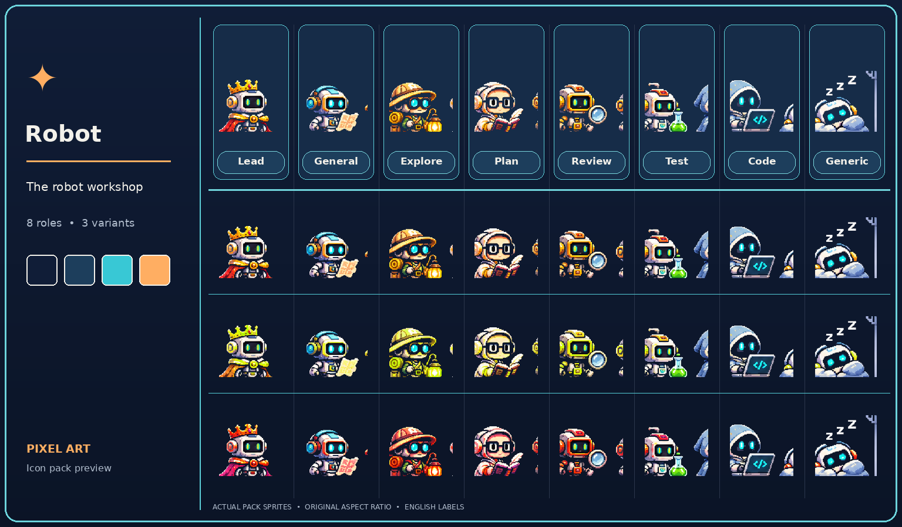
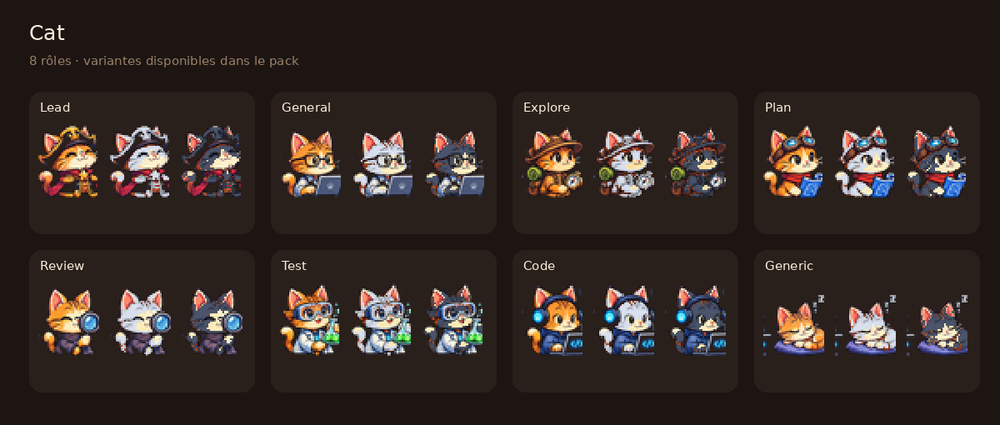
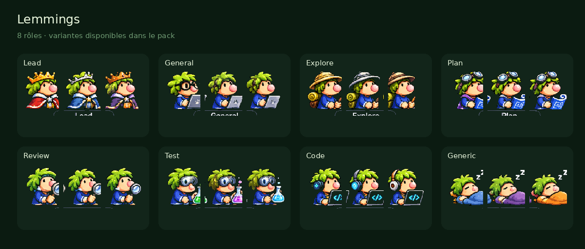
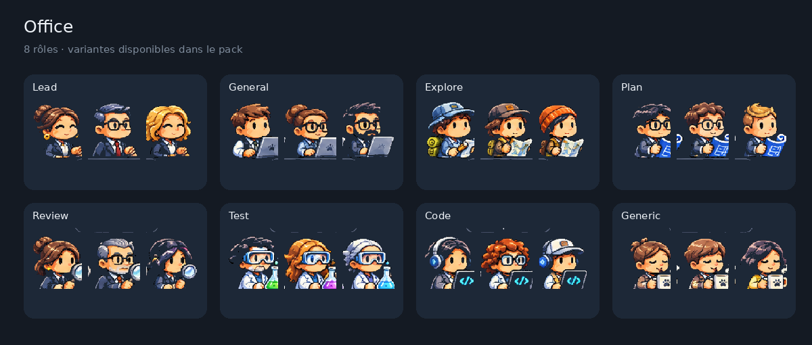
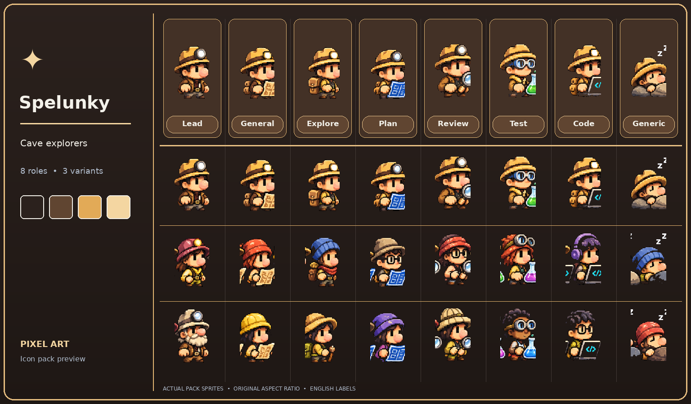
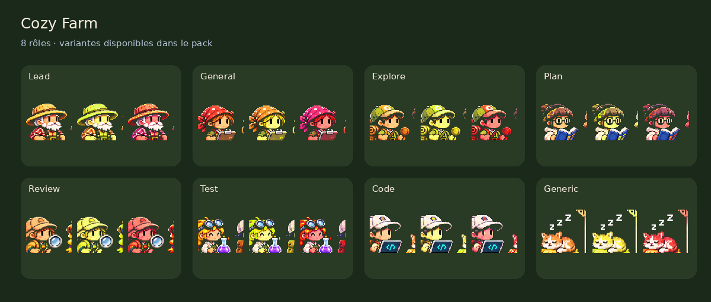
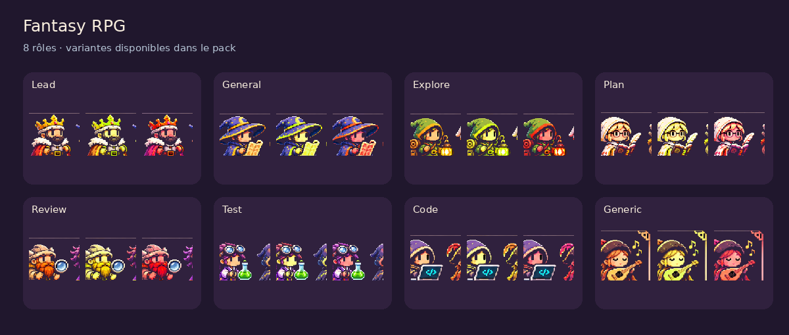
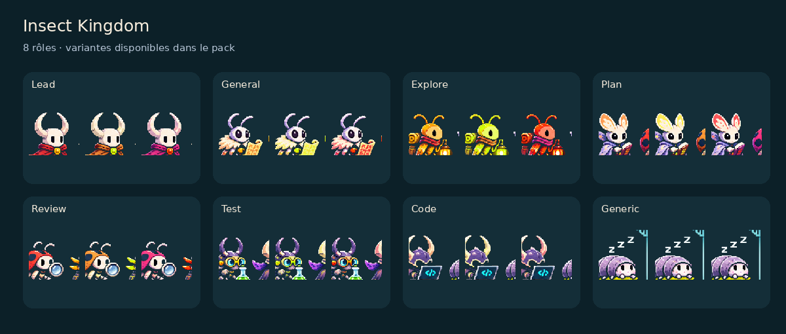
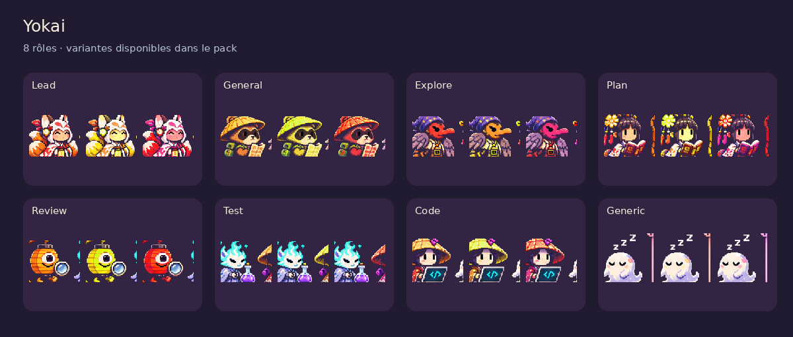

# standup-bot themes

Themes and icon packs for [standup-bot](https://github.com/tfabien/standup-bot), the agent standup screen for Claude Code. standup-bot ships with the `default` theme and the `robot` pack only. Everything else lives here.

| Theme | Icon pack | Look |
| --- | --- | --- |
| `cat` | `cat` | Warm brown palette, one cat coat per role |
| `lemmings` | `lemmings` | Dark green palette, the walking lemming of the game with the tool of a skill per role |
| `office` | `office` | Slate blue palette, a colleague in a suit per role |
| `pirates` | `pirates` | Night sea palette with a wood frame, a crew member per role |
| `spelunky` | `spelunky` | Cave brown palette, an explorer per role |
| `cozy-farm` | `cozy-farm` | Cozy farm palette, a farm character per role |
| `fantasy-rpg` | `fantasy-rpg` | Fantasy palette, an adventurer class per role |
| `insect-kingdom` | `insect-kingdom` | Insect palette, a bug per role |
| `yokai` | `yokai` | Japanese folklore palette, a yokai per role |
| `noel` | `noel` | Night blue palette, Santa's workshop: Santa, elf, reindeer, snowman, penguin and polar bear |

## Previews

The eight roles of each pack, with their variants. `default` (pack `robot`) is the theme built into standup-bot.

### default



### cat



### lemmings



### office



### pirates


### spelunky



### cozy-farm



### fantasy-rpg



### insect-kingdom



### yokai



### noel


## Install

Ask Claude Code: "install the standup-bot themes from tfabien/standup-bot-themes". It follows [install.md](install.md). With the standup-bot plugin, the `install-theme` skill does the same.

By hand: copy `themes/*.json` into `~/.claude/standup-bot/themes/` and `icons/<pack>/` into `~/.claude/standup-bot/icons/`, then reload the page theme dialog. Details in [install.md](install.md).

## Make a theme

A theme is one JSON file plus, optionally, an icon pack folder. [install.md](install.md#create-a-theme) lists every constraint (names, colors, icon files, sizes) so Claude Code or a person can create one that the hub accepts.

Layout of this repository:

```
themes/<name>.json            the colors and the name of the icon pack
icons/<pack>/<role>.png       one image per role (svg, png, webp, gif or jpg)
```

Add your theme in a pull request: one `themes/<name>.json`, its `icons/<pack>/` folder, and a row in the table above.
